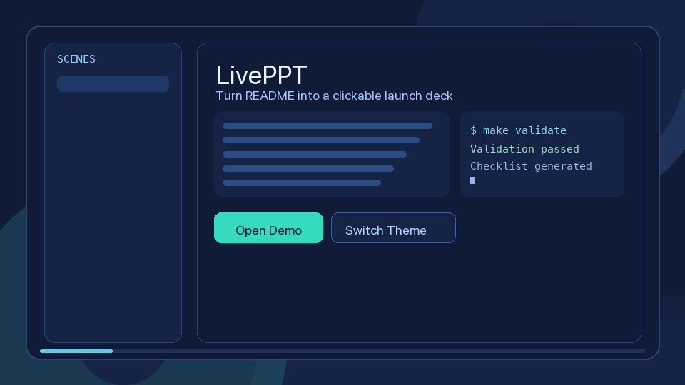

<div align="center">

# 🎬 LivePPT

**把 Markdown / README 变成可点击、可翻页、可分享的 HTML 演示页。**

[](#授权说明)
[](https://github.com/AIPMAndy/LivePPT)

**简体中文**



</div>

---

## LivePPT 是什么

LivePPT 不是传统 PPT 工具，也不是单纯的 README 模板。

它更像一个“演示页生成器”：
- 输入 Markdown 内容 / README
- 一条命令生成 HTML
- 结果可以直接打开、翻页、演示、分享

一句话：**先把内容变成结果，再逐步升级成更高级的演示体验。**

## 为什么用它

| 能力 | 静态 PPT | 普通 README | **LivePPT** |
|------|:--------:|:-----------:|:-----------:|
| 直接生成 HTML 演示页 | ❌ | ❌ | ✅ |
| 点击翻页 + 键盘控制 | ⚠️ | ❌ | ✅ |
| 一套内容切换不同主题风格 | ❌ | ❌ | ✅ |
| README 直接转演示页 | ❌ | ❌ | ✅ |
| 轻量脚本化工作流 | ⚠️ | ❌ | ✅ |

## 🌐 在线体验

- [项目官网 / 在线演示](https://aipmandy.github.io/LivePPT/)（仓库 Pages 启用后可用）
- [实际 Demo 源码](skills/public/LivePPT/demos/liveppt-promo/index.html)
- [自动化回归测试](skills/public/LivePPT/tests/test_renderer.py)

网页首页位于仓库根目录 `index.html`，无需 Node.js 构建。首次部署参见 [GitHub Pages 配置步骤](DEPLOYMENT.md)。

## 30 秒快速开始

```bash
git clone https://github.com/AIPMAndy/LivePPT.git
cd LivePPT/skills/public/LivePPT
make validate
```

### 最短路径：现成 README 直接生成 HTML

```bash
make build-from-readme \
  README_INPUT=README.md \
  OUTPUT=dist/readme-deck.html \
  STYLE=prism-command \
  BRAND="LivePPT"
```

然后直接打开：

```bash
open dist/readme-deck.html
```

### 如果你没有内容，再一条命令生成 HTML

```bash
make build-showcase \
  PROJECT="AI 产品发布网页演示" \
  AUDIENCE="技术决策者" \
  STYLE=neo-luxury \
  BRAND="LivePPT" \
  PLAN=plans/showcase.md \
  OUTPUT=dist/index.html
```

## 当前核心能力

- `build-from-readme`：README 直接生成 HTML deck
- `build-showcase`：一条命令生成 Markdown 内容 + HTML
- `render_plan_to_html.py`：把 Markdown 渲染为单文件 HTML deck
- `add_theme.py`：生成主题 token CSS
- 支持主题、品牌名、封面副标题参数
- 支持翻页、导航点、进度条、键盘控制

## 适合场景

- 开源项目发布：把 README / 更新日志变成演示页
- 产品发布：快速做可讲解、可分享的网页演示
- B 端售前：同一内容切不同视觉风格
- 课程讲义：把知识内容拆成节奏化页面

## 项目结构

```bash
LivePPT/
├── README.md
└── skills/public/LivePPT/
    ├── README.md
    ├── SKILL.md
    ├── scripts/
    │   ├── build_from_readme.py
    │   ├── build_showcase.py
    │   ├── render_plan_to_html.py
    │   ├── generate_showcase_plan.py
    │   └── add_theme.py
    ├── demos/
    ├── examples/
    ├── references/
    └── releases/
```

## 当前边界

当前这版已经能解决：
- Markdown / README 直接出 HTML
- 快速得到一个可演示、可分享的结果
- 同一份内容切换不同主题风格

当前还没完全解决：
- 任意 README 无损高保真转发布会页面
- 复杂布局自动识别
- 一键导出完整静态站资源包
- 更细粒度的页面模板系统

所以现阶段更适合把它理解成：
**“把内容快速变成演示页”的 MVP**。

## 更多文档

- Skill 文档：`skills/public/LivePPT/README.md`
- 技能定义：`skills/public/LivePPT/SKILL.md`
- 贡献说明：`skills/public/LivePPT/CONTRIBUTING.md`
- 路线图：`skills/public/LivePPT/ROADMAP.md`

<!-- andy-author-card:start -->
## 作者 / About the author

**AI 酋长 Andy（Andy Liu，GitHub/X @AIPMAndy）**：前腾讯/百度 AI 产品专家，大模型独角兽前 VP，现专注 AI + 产品方法论创业。

可以找我聊求职咨询、AI 增长和副业陪跑，服务范围和费用先沟通确认。

微信 `AIPMAndy`（备注「LivePPT」）· [X @AIPMAndy](https://x.com/AIPMAndy) · [Telegram @AIPMAndy](https://t.me/AIPMAndy) · [个人官网 metaver.vip](https://metaver.vip/) · [Grok Bot 中文攻略](https://aipmandy.github.io/grok-bot-handbook/)

*AI Chief Andy (Andy Liu, @AIPMAndy on GitHub and X) is a former Tencent and Baidu AI product expert and former VP at an LLM unicorn, now a serial entrepreneur focused on AI and product methodology.*

### 作者的其他项目

- [Grok Bot 中文攻略](https://github.com/AIPMAndy/grok-bot-handbook)：Grok Bot / AI Agent 中文教程，26 章加 40 套任务指令
- [AndySoul](https://github.com/AIPMAndy/AndySoul)：CLAUDE.md / AGENTS.md 规则模板，让 Claude Code、Codex、Cursor 少犯错
- [一个人靠 AI 赚钱](https://github.com/AIPMAndy/one-person-ai-income-guide)：验证需求、第一笔收款、交付与复购，附 30 天计划
- [FreeToken](https://github.com/AIPMAndy/FreeToken)：免费 AI API、免费大模型 API 额度合集

<!-- andy-author-card:end -->

## 授权说明

**当前仓库存在两份不同的许可文本，尚待作者统一授权口径：**

- [根目录 LICENSE](LICENSE)：Apache License 2.0。
- [Skill 目录 LICENSE](skills/public/LivePPT/LICENSE)：MIT 文本及限制商业 SaaS、转售和去品牌化的附加条款。

两份文本在商业使用范围上可能存在冲突。请勿简单将整个项目描述为“统一采用 Apache/MIT 开源协议”；涉及商用或再分发，请先向作者确认适用条款。联系：**微信 AIPMAndy**。

---

<div align="center">

**如果这个项目对你有帮助，欢迎点个 ⭐ Star**

</div>
